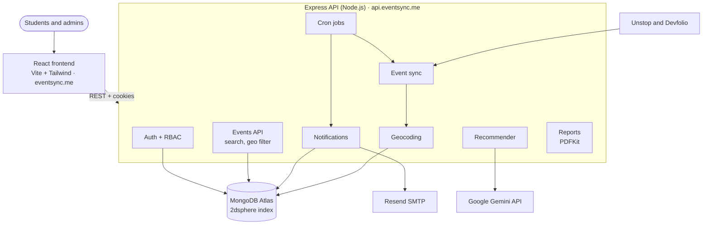
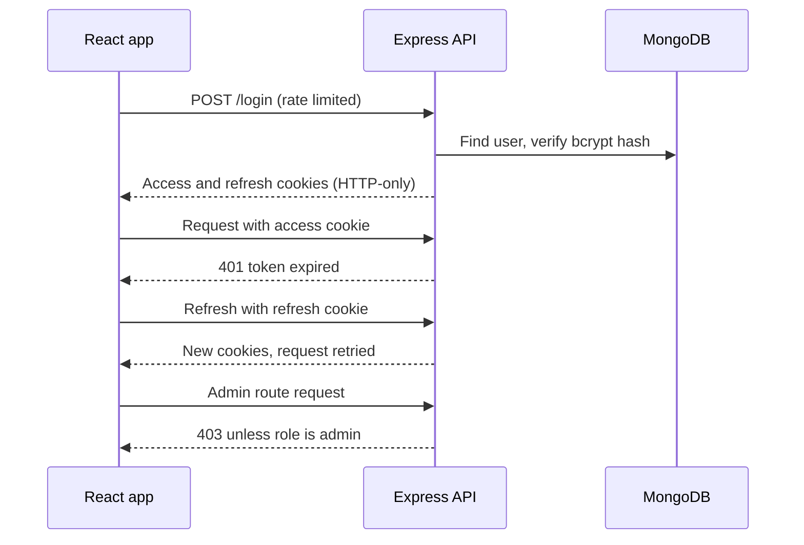
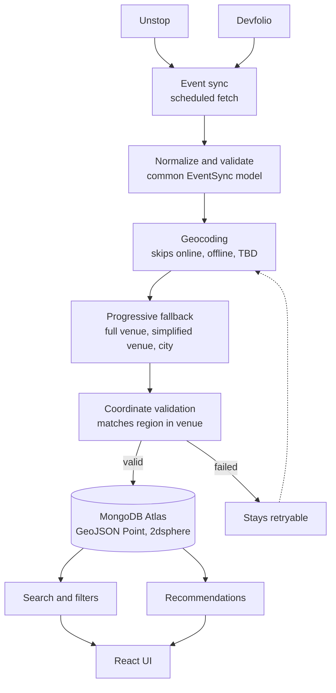
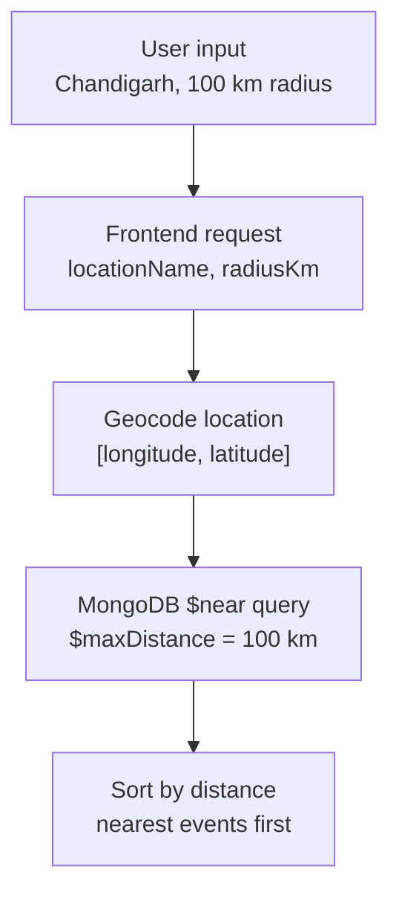
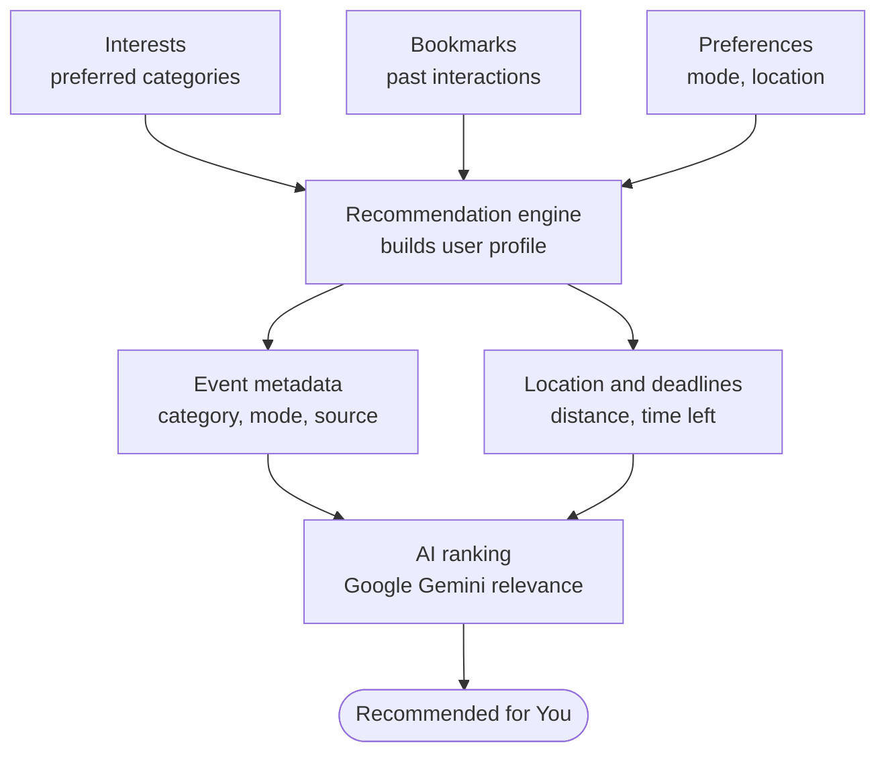
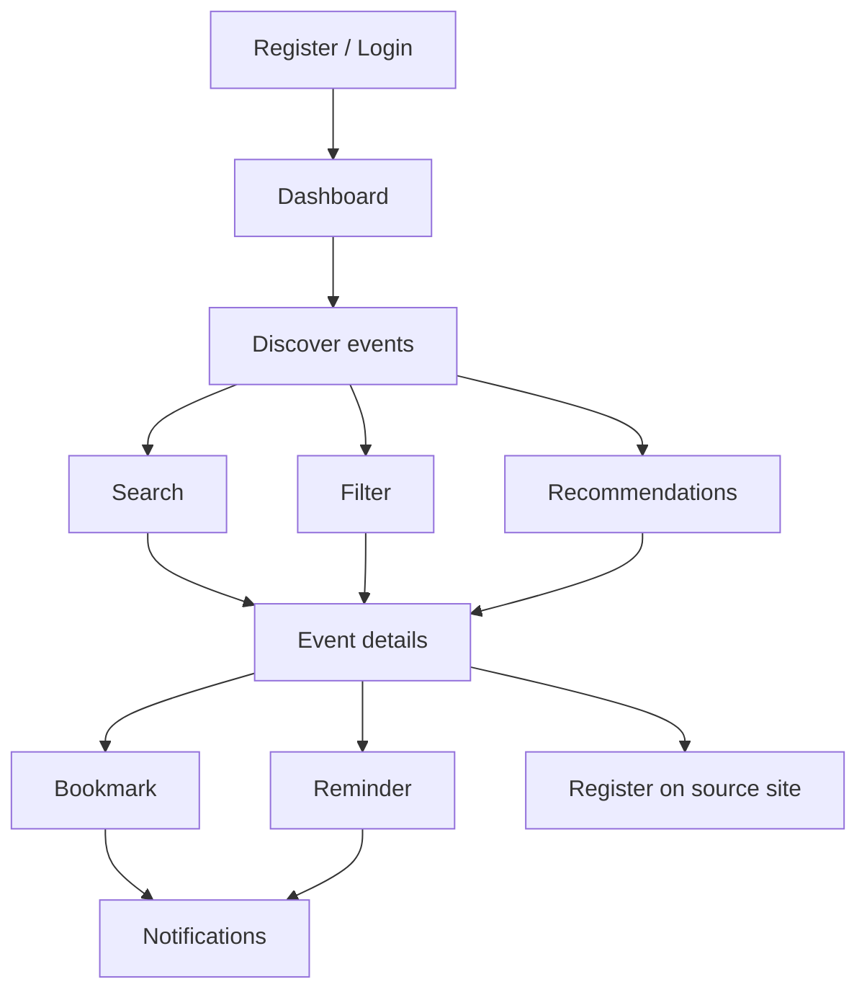
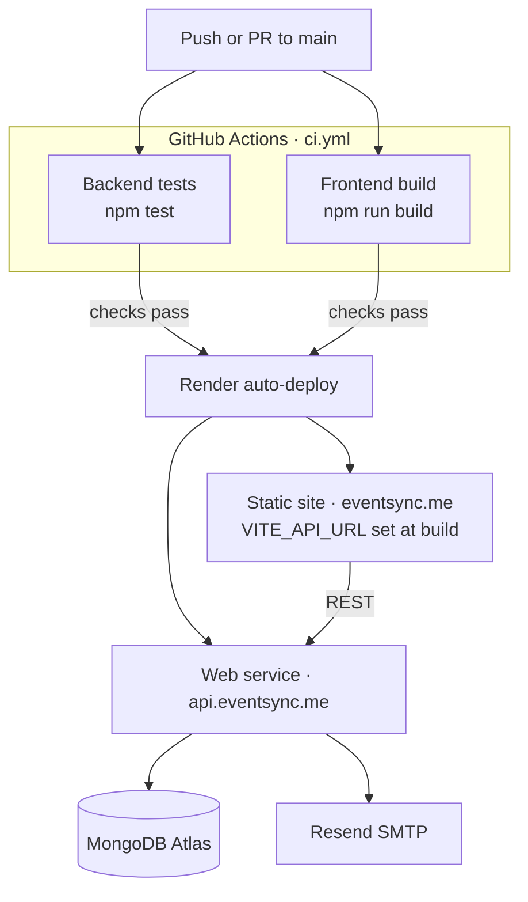

# 🎓 EventSync
 


 
**Intelligent, location-aware student event discovery and personalized recommendations, all in one place.**
 
**🌐 Live demo: [https://eventsync.me](https://eventsync.me)**
 
> The backend runs on a free hosting plan that sleeps when idle, so the first load can take about 30 seconds.
 
## Table of Contents
 
- [Overview](#overview)
- [The Problem EventSync Solves](#the-problem-eventsync-solves)
- [System Architecture](#system-architecture)
- [End-to-End System Lifecycle](#end-to-end-system-lifecycle)
- [Features](#features)
- [Geospatial Data Strategy](#geospatial-data-strategy)
- [Tech Stack](#tech-stack)
- [Project Structure](#project-structure)
- [Getting Started](#getting-started)
  - [Prerequisites](#prerequisites)
  - [Option A: Local Development Setup](#option-a-local-development-setup)
  - [Environment Configuration](#environment-configuration)
- [Example: Location Search](#example-location-search)
- [Deployment & CI/CD](#deployment--cicd)
- [Testing](#testing)
- [Operational Resilience](#operational-resilience)
- [Boundaries & Limitations](#boundaries--limitations)
- [Roadmap](#roadmap)
- [Team](#team)
---
 
## Overview
 
**EventSync** is a full-stack MERN platform that gathers hackathons, workshops, conferences, competitions and internships from platforms such as **Unstop** and **Devfolio** into one searchable catalog. It filters events by interest and location and recommends the ones that matter to each student.
 
EventSync is split into three layers:
 
- **React frontend:** dashboard, discovery, bookmarks, notifications and the admin console, served as a static site.
- **Express API:** authentication, event search, recommendations, notifications, scheduled jobs, event sync, geocoding and reports.
- **Data and integrations:** MongoDB Atlas with a geospatial index, Google Gemini for AI relevance, Resend for email, and Unstop and Devfolio as event sources.
## The Problem EventSync Solves
 
Students find events through disconnected platforms, social posts and college groups. That causes four recurring problems:
 
| Problem | How EventSync solves it |
|---|---|
| Relevant events are hard to find | Unified catalog with search, filters and a personalized **Recommended for You** feed |
| Nearby events are invisible | Radius search such as "within 100 km of Chandigarh", sorted nearest first |
| Deadlines get missed | In-app notifications and scheduled deadline reminders |
| External data is messy | Normalization, validation and a geocoding pipeline with fallback queries and coordinate checks |
 
---
 
## System Architecture
 

 
| Component | Responsibility |
|---|---|
| React frontend | UI, routing, API calls with cookie-based sessions |
| Auth and RBAC | Registration, login, token refresh, student and admin roles |
| Events API | Search, filters, pagination, geospatial queries |
| Recommender | Personalized ranking using user activity and Gemini |
| Notifications | In-app alerts for bookmarks, deadlines and reminders |
| Cron jobs | Scheduled event sync and deadline reminders (`node-cron`) |
| Event sync | Fetches, normalizes and validates events from Unstop and Devfolio |
| Geocoding | Converts venue text to validated coordinates |
| Reports | PDF report generation with PDFKit |
 
---
 
## End-to-End System Lifecycle
 
### Phase 0: Server boot
 
- Loads environment configuration, initializes `winston` logging and connects to MongoDB.
- Registers `helmet`, CORS limited to the configured client origin and rate limiters.
- Starts the cron jobs inside the server process, which is why the backend runs as a single instance.
- Installs shutdown handlers that close the HTTP server and the database connection cleanly.
### Phase 1: Authentication and session
 

 
- Passwords are hashed with bcrypt, and login, registration and password reset are rate limited.
- JWT access and refresh tokens are stored in HTTP-only cookies and refreshed automatically.
- Role-based middleware restricts admin routes to administrators.
### Phase 2: Event synchronization
 
- A scheduled job fetches events from **Unstop** and **Devfolio**.
- Records are normalized into the common `Event` model and validated before they are stored.
- Each run is recorded in `SyncLog`, and admins can trigger and monitor sync from the dashboard.
### Phase 3: Geocoding and coordinate validation
 

 
- Generic venues (`offline`, `online`, `hybrid`, `TBD`, `TBA`) are never geocoded.
- Progressive fallback: full venue address, then simplified venue, then city or locality.
- Coordinates are validated against the region named in the venue and stored as GeoJSON.
- Events that fail geocoding stay retryable instead of being dropped.
### Phase 4: Discovery and location search
 

 
- Text search and filters on category, location, mode, deadline, source and verification status.
- Radius search resolves a place name or browser location to coordinates, then runs a MongoDB `$near` query.
### Phase 5: Personalized recommendations
 

 
- The engine builds a profile from interests, preferred categories, bookmarks and past interactions.
- Candidates are scored on event metadata, location, mode and upcoming deadlines, then ranked with Gemini.
### Phase 6: Bookmarks, notifications and reminders
 
- Students bookmark events, and bookmarks feed back into recommendations.
- Notifications are created for bookmark activity, deadlines and reminders.
- `ReminderLog` records reminder activity, and reminder emails are sent from `noreply@eventsync.me`.
### Phase 7: Administration
 
- KPI overview, event create, edit, delete and verify, location assignment.
- Reports and analytics covering events, categories, sources, bookmarks and sync activity.
### Typical user flow
 

 
---
 
## Features
 
### Roles
 
| Role | Capabilities |
|---|---|
| 👤 Student | Discover, search, filter and bookmark events; notifications and reminders; personalized recommendations |
| 🛡️ Admin | Dashboard KPIs, event management, verification, reports and analytics, sync monitoring |
 
### Event data
 
Each event stores its title, description, category, organizer, venue, location, mode, registration deadline, event date, registration link, source, verification status and distance from the selected location.
 
### Event modes
 
| Mode | Location handling |
|---|---|
| 🏢 Offline | Has a geographic location and appears in radius search |
| 💻 Online | No coordinates required |
| 🔀 Hybrid | Physical and virtual, geocoded when a real venue exists |
 
### Other features
 
- **Verification:** events can be marked verified and filtered by verification status.
- **Gamification:** progress, participation, achievements and activity milestones.
- **Pagination:** active search, filter and location settings are preserved across pages.
---
 
## Geospatial Data Strategy
 
Physical event locations are stored as GeoJSON points in `[longitude, latitude]` order:
 
```javascript
{
  type: "Point",
  coordinates: [longitude, latitude]
}
```
 
A `2dsphere` index on `location` supports radius search with `$near` and `$maxDistance`, which gives radius filtering and nearest-first ordering. Online events without coordinates are excluded from radius searches.
 
---
 
## Tech Stack
 
| Layer | Technologies |
|---|---|
| Frontend | React 18, Vite, React Router DOM, Tailwind CSS, Axios |
| Backend | Node.js, Express.js, Mongoose, JWT, bcrypt, node-cron, Nodemailer, PDFKit, helmet, winston |
| AI | Google Gemini API |
| Database | MongoDB Atlas with a `2dsphere` geospatial index |
| Email | SMTP via Resend |
| CI/CD and hosting | GitHub Actions, Render |
 
**Core models:** `User`, `Event`, `Notification`, `ReminderLog`, `SyncLog`
 
---
 
## Project Structure
 
```text
EventSync/
├── .github/
│   └── workflows/
│       └── ci.yml
├── frontend/
│   ├── src/
│   │   ├── components/
│   │   ├── pages/
│   │   ├── context/
│   │   └── services/
│   ├── package.json
│   └── vite.config.js
├── backend/
│   ├── src/
│   │   ├── controllers/
│   │   ├── models/
│   │   ├── routes/
│   │   ├── services/
│   │   ├── utils/
│   │   └── scripts/
│   └── package.json
├── .gitignore
└── README.md
```
 
---
 
## Getting Started
 
### Prerequisites
 
- Node.js and npm
- A MongoDB Atlas account or a local MongoDB instance
- Git
- Optional: Google Gemini API key and SMTP credentials
### Option A: Local Development Setup
 
**1. Clone the repository**
 
```bash
git clone https://github.com/Shruti06gupta/EventSync.git
cd EventSync
```
 
**2. Start the backend** at `http://localhost:5000`
 
```bash
cd backend
npm install
npm run dev
```
 
Use `npm start` to run without auto-reload.
 
**3. Start the frontend** at `http://localhost:5173`, in a second terminal
 
```bash
cd frontend
npm install
npm run dev
```
 
### Environment Configuration
 
Create `backend/.env`:
 
```env
NODE_ENV=development
PORT=5000
CLIENT_URL=http://localhost:5173
 
MONGO_URI=your_mongodb_connection_string
 
JWT_SECRET=your_jwt_secret
JWT_REFRESH_SECRET=your_jwt_refresh_secret
 
GEMINI_API_KEY=your_gemini_api_key
 
SMTP_HOST=smtp.resend.com
SMTP_PORT=465
SMTP_USER=resend
SMTP_PASS=your_resend_api_key
EMAIL_FROM=noreply@eventsync.me
```
 
Create `frontend/.env`:
 
```env
VITE_API_URL=http://localhost:5000
```
 
| Variable | Purpose |
|---|---|
| `MONGO_URI` | MongoDB connection string |
| `JWT_SECRET`, `JWT_REFRESH_SECRET` | Signing secrets for access and refresh tokens |
| `CLIENT_URL` | Allowed CORS origin |
| `GEMINI_API_KEY` | Enables AI-assisted recommendations |
| `SMTP_*`, `EMAIL_FROM` | Transactional email through Resend |
| `VITE_API_URL` | API address, read at frontend build time |
 
> Variable names must match the backend configuration. Never commit `.env` files or API keys.
 
---
 
## Example: Location Search
 
Search for events within **100 km of Chandigarh**:
 
1. The frontend sends `locationName=Chandigarh&radiusKm=100`.
2. The backend geocodes the place to `[76.7797143, 30.7334421]` (longitude, latitude).
3. MongoDB runs `$near` with `$maxDistance` set to 100 km.
4. Results are returned nearest first:
| Event | Distance |
|---|---|
| Innosprint2.0 | 0.00 km |
| Srijan Setu | 19.13 km |
| BIOS V2 | 71.94 km |
 
---
 
## Deployment & CI/CD
 

 
| Part | Where | Address |
|---|---|---|
| Frontend (React/Vite static site) | Render Static Site | https://eventsync.me |
| Backend (Express API) | Render Web Service | https://api.eventsync.me |
| Database | MongoDB Atlas | private |
| Transactional email | SMTP via Resend, sent from `noreply@eventsync.me` | — |
 
### CI pipeline
 
Every push and pull request to `main` runs `.github/workflows/ci.yml`:
 
- **Backend tests:** installs dependencies and runs `npm test` (production-hardening and graceful-shutdown checks)
- **Frontend build:** installs dependencies and runs `npm run build`
Render auto-deploys only after these checks pass, so a failing commit never reaches the live site.
 
### Deployment notes
 
- Set `VITE_API_URL` to the API address at frontend build time.
- Add a Render Rewrite rule `/*` → `/index.html` so links such as `/reset-password` open directly.
- Run the backend as a single instance, because the scheduled jobs (event sync and deadline reminders) run inside the server process.
- The frontend and API share the parent domain `eventsync.me`, so login cookies work with `SameSite=Lax`.
### Production hardening
 
- JWT access and refresh tokens in HTTP-only cookies, with automatic refresh
- `helmet` security headers and CORS limited to the configured client origin
- Rate limiting on login, registration, password reset, chatbot and sync endpoints
- Structured logging with `winston`, with passwords and tokens automatically redacted
- Graceful shutdown that closes the HTTP server and the database connection cleanly
- Server-side validation, role-based authorization and secrets kept in environment variables
---
 
## Testing
 
| Area | What to verify |
|---|---|
| Authentication | Registration, login, logout, protected routes, role-based access |
| Discovery | Search, category filters, pagination, event details |
| Geospatial search | Chandigarh with a 100 km radius returns nearby events sorted by distance |
| Recommendations | Preferences and bookmarks influence the results |
| Admin | Event create and edit, analytics, reports, access control |
 
Backend checks run automatically in CI with `npm test`.
 
---
 
## Operational Resilience
 
- **Graceful shutdown:** the HTTP server and the database connection close cleanly on termination.
- **Retryable geocoding:** events that fail geocoding are kept and retried, never discarded.
- **Rate limiting:** login, registration, password reset, chatbot and sync endpoints are protected against abuse.
- **Safe logging:** `winston` redacts passwords and tokens automatically.
- **Gated deployments:** Render deploys only after backend tests and the frontend build pass.
- **Audit trail:** `SyncLog` and `ReminderLog` record sync and reminder activity.
## Boundaries & Limitations
 
- **Single instance:** cron jobs run inside the API process, so running multiple backend instances would duplicate scheduled work.
- **Cold starts:** the free hosting plan sleeps when idle, so the first request can take about 30 seconds.
- **Radius search scope:** online events and events without valid coordinates are excluded from radius results.
- **Event sources:** synchronization currently covers Unstop and Devfolio.
---
 
## Roadmap
 
- Interactive map-based event discovery and route visualization
- Push notifications and Progressive Web App support
- Calendar integration
- Hybrid recommendation algorithms with AI explanations and preference learning
- More event-source integrations
- Expanded gamification and achievements
- Real-time event updates
## Team
 
Developed as a collaborative student project by **Shruti Gupta**, **Vani Gupta** and contributors.
 
## License
 
This project is developed for educational purposes. See the repository license for terms.
 
**Built with ❤️ using the MERN stack.**
 